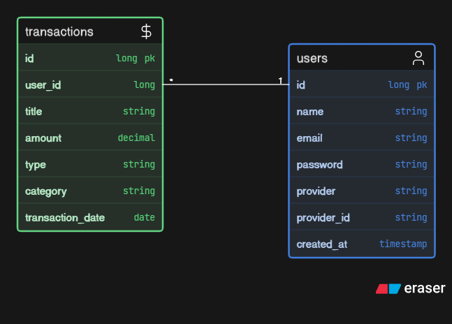

# PennyWise

An AI-powered personal finance platform built with Spring Boot, PostgreSQL.

## Backend Setup

Requirements: Java and Maven wrapper.

From the repository root:

```powershell
cd backend
.\mvnw.cmd clean compile 
```

## Database design



